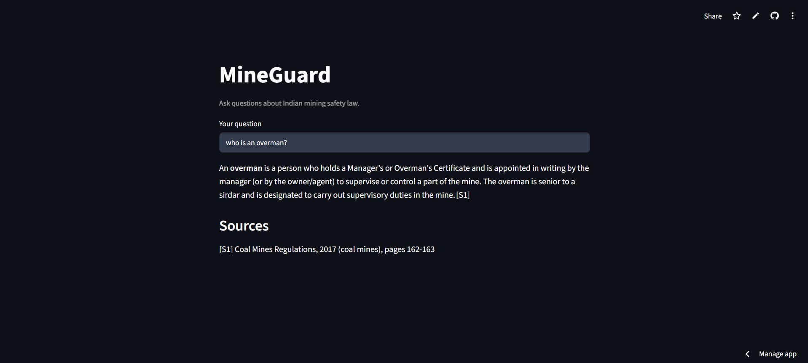

# MineGuard

An AI assistant for Indian mining safety law. Ask a question in plain English (or Hinglish), and MineGuard searches the actual regulations and answers with citations to the exact document and pages.

**Live demo:** https://mineguard-ai.streamlit.app/

> MineGuard is a study and decision-support tool, not legal advice. The legally responsible person at a mine still makes the call.



## Why I built this

Hi there! I am Sarim, a sophomore studying Mining Engineering at NIT Rourkela. Mine managers and safety officers need to deal with a lot of issues at the mine site on a daily basis. MIning is governed by a lot of laws and regulations and it is practically next to impossible for an individual to remember hundreds of pages of dense legal text. The rules that matter in an emergency situation are often split across clauses and different sections and the same issue is handled differently for coal and metal mines. This is why I came up with MineGuard. It is a hobby project in its nascent phase and am planning to grow it further.

MineGuard currently covers:

- The Mines Act, 1952
- The Coal Mines Regulations, 2017
- The Metalliferous Mines Regulations, 1961
- The Mines Rescue Rules, 1985

## What it does

- **Answers with citations.** Every fact is tied to a source ID like `[S2]`, and the app lists the real document and page range for each one.
- **Handles multi-part questions.** An agent decides what to search for. A question like *"What is the gas limit for a degree two seam, and how many hours can a worker spend underground?"* becomes two separate searches, combined into one answer.
- **Keeps coal and metal mine rules apart** when they differ, and states a rule once when it applies to all mines.
- **Says "I could not find this in the regulations"** instead of guessing.

## How it works

```
PDFs → clean text → 200-word chunks → embeddings → ChromaDB
                                                      │
question → agent (LLM) → search tool → merged passages → cited answer
```

1. **Loading and cleaning.** The Coal Mines Regulations PDF is a bilingual Gazette. The Hindi pages use a legacy font and extract as Latin-letter gibberish, so a filter keeps only English pages, and the running Gazette headers (in both languages) are stripped. 307 pages are kept.
2. **Chunking.** 1,141 chunks of 200 words with a 40-word overlap.
3. **Embeddings and search.** `all-MiniLM-L6-v2` embeddings stored in ChromaDB (cosine distance).
4. **Neighbour expansion and passage merging.** Each search hit is expanded with the chunks before and after it (same document only), and consecutive chunks are merged into one continuous passage with a page range. This was needed because regulations often run across chunk and page boundaries.
5. **The agent.** An LLM (`openai/gpt-oss-120b` via Groq) with a `search_regulations` tool, running in a loop with a step limit.
6. **Honest citations.** The LLM cites only source IDs (`[S1]`, `[S2]`...). The code maps each ID to its real document and pages, and flags any ID that was never returned by a search. The model cannot invent a page number.

## Evaluation

I built an eval set of 21 questions with answers checked against the PDFs: formal questions, casual rewordings, a Hinglish question, and questions whose correct answer appears in more than one document.

| Metric | Score |
|---|---|
| Retrieval hit rate @5 | 20/21 |
| MRR (mean reciprocal rank) | 0.740 |

### Experiments

Every change was measured against the eval before being kept.

| Change | Result | Decision |
|---|---|---|
| Stripping garbled Hindi headers | Correct chunk for a gas question moved from rank 2 to rank 1 | Kept |
| Switching pypdf to PyMuPDF | Fixed broken words ("reg ulation" → "regulation") | Kept |
| Merging neighbouring chunks into passages | Gas-threshold answer went from missing the limits to giving all three (0.1% / 0.5% / 1.25% by seam degree) | Kept |
| LLM query rewriting (20-question set, baseline MRR 0.777) | MRR 0.568; with RRF fusion 0.735–0.772, varying between runs | Rejected |
| Hybrid BM25 + embeddings with stemming | Fixed an exact-term question, but MRR 0.694 vs 0.740 overall | Kept as an option, off by default |

Two things these experiments taught me: an answer key can be wrong (two "failures" were actually better answers than the ones I'd written down), and an idea that sounds smart still needs to be measured.

## Known limitations

- **One retrieval gap:** asked for the gas detection limit in a degree-two seam, MineGuard can return the seam *classification* rule (0.1%) instead of the *detection* limit (0.5%). Hybrid search fixes this question but lowers the overall score, so it is off for now.
- **Casual wording ranks lower.** For example, "breathing sets" finds the right page at rank 5, while "breathing apparatus" finds it at rank 1–3.
- Covers four documents only. DGMS circulars are not included yet.
- With 21 questions, small score differences may be noise. The eval set needs to grow before further tuning.

## Tech stack

Python · PyMuPDF · sentence-transformers · ChromaDB · rank-bm25 · Groq API · Streamlit

## Run it locally

```
python -m venv .venv
.venv\Scripts\activate          (on Mac/Linux: source .venv/bin/activate)
pip install -r requirements.txt
```

Create a `.env` file in the project folder:

```
GROQ_API_KEY=your_key_here
```

Then:

```
python src/build_index.py       (only needed if db/ is missing)
streamlit run src/app.py
```

Run the retrieval eval:

```
python src/eval_retrieval.py
```

## Project structure

```
data/raw/            source PDFs
src/load_pdfs.py     PDF loading, English-page filter, header cleaning
src/chunk.py         chunking with overlap
src/build_index.py   embeddings + ChromaDB index
src/search.py        search, neighbour expansion, passage merging, hybrid search
src/answer.py        single-step RAG answer (original version)
src/agent.py         tool-calling agent with source-ID citations
src/rewrite.py       query rewriting (experiment, off by default)
src/app.py           Streamlit app
src/eval_retrieval.py  retrieval eval (hit rate, MRR)
evals/questions.json   eval set
experiments/         one-off test scripts
DEVLOG.md            what I tried, what broke, and what I learned
```

## Roadmap

- Grow the eval set to around 50 questions
- An ML risk model trained on accident data, added as an agent tool
- More documents, starting with DGMS circulars
- A production version with a FastAPI backend and a React frontend

## Author

Sarim Ahmed, NIT Rourkela
